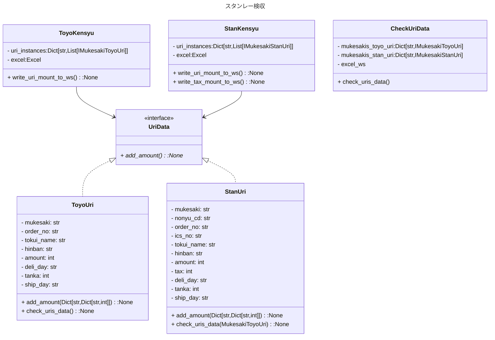

# Stanley Kensyu(スタンレー検収自動チェックプログラ厶)

        columns = ['No', 'unknown1', 'date', 'unknown2', 'unknown3', 
                'unknown4', 'order_no', 'unknown5', 'unknown6', 'tani', 
                'unknown7', 'unknown8', 'hin_name', 'unknown9', 'ics_no', 
                'nonyu_cd', 'tanka', 'amount', 'qty', 'deli_day', 'unknown10', 
                'unknown11', 'unknown12', 'unknown13', 'unknown14', 
                'order_day', 'unknown15', 'unknown16', 'unknown17', 
                'unknown18', 'unknown19', 'tax', 'unknown20'
